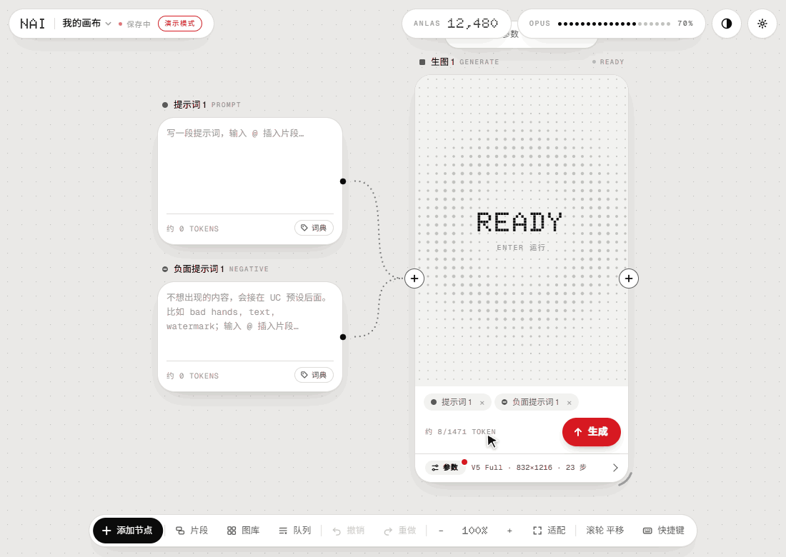
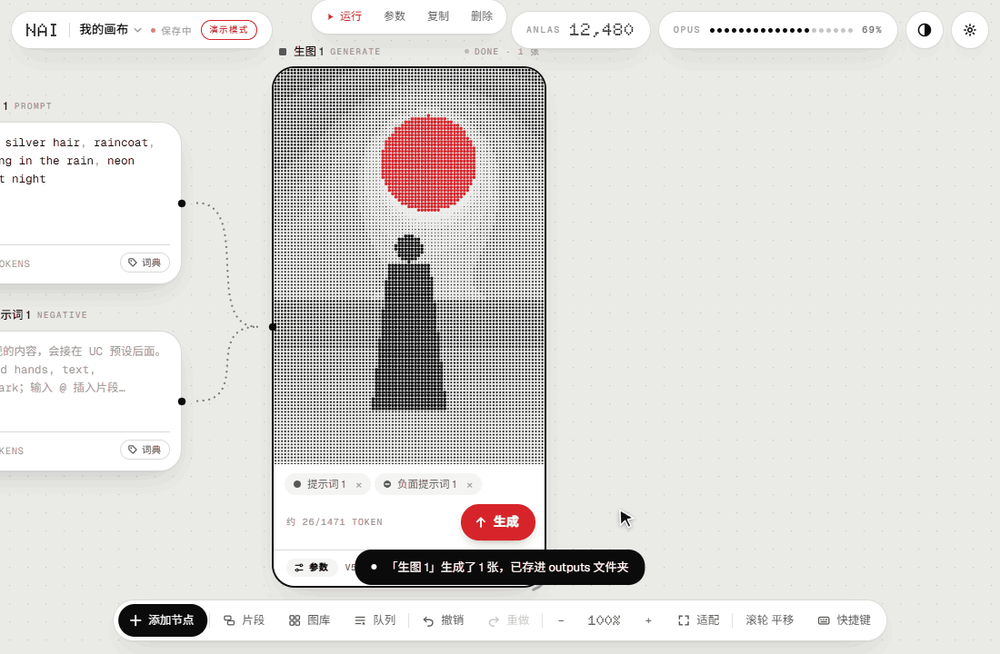
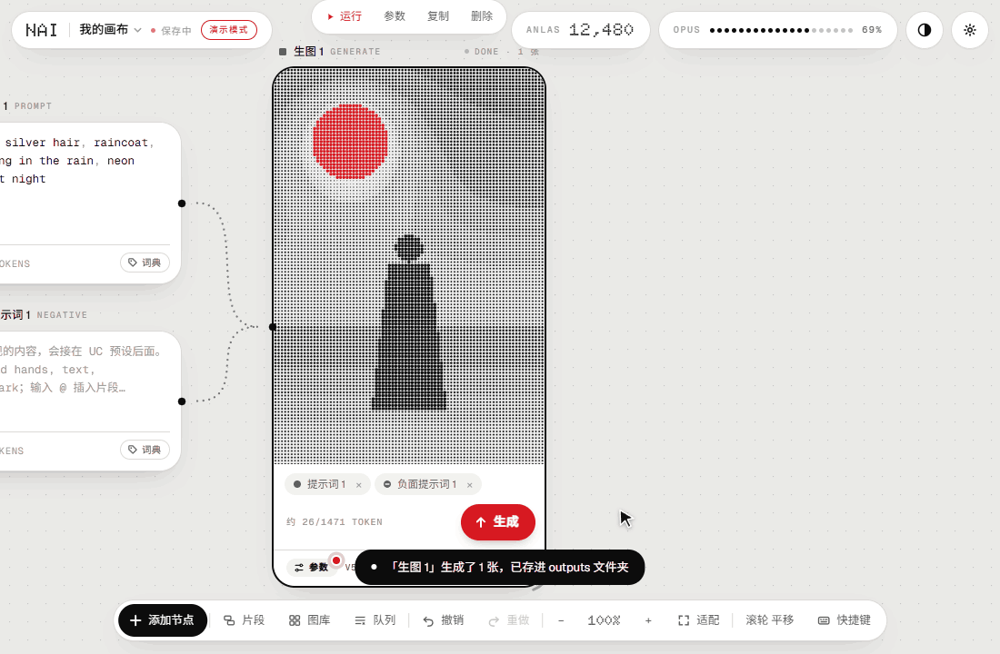
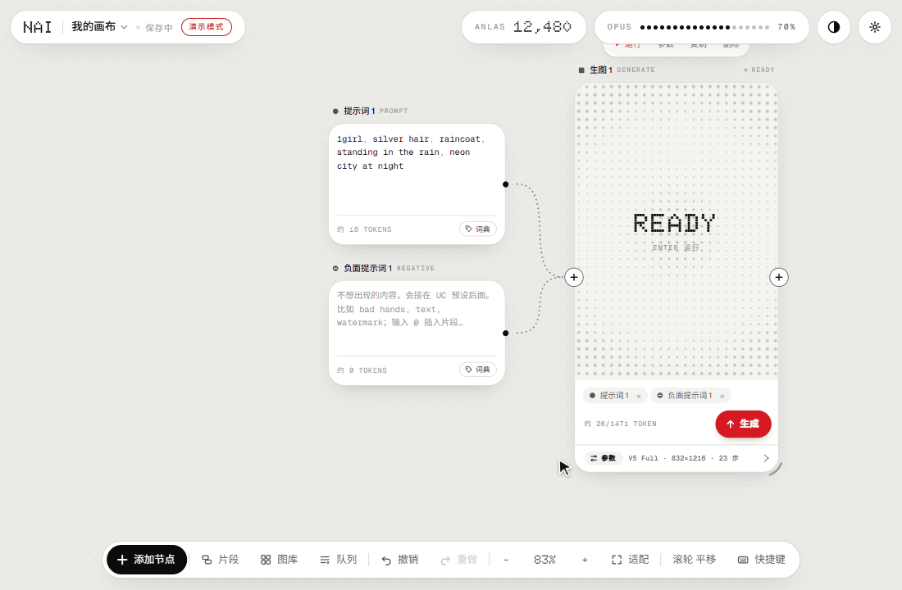
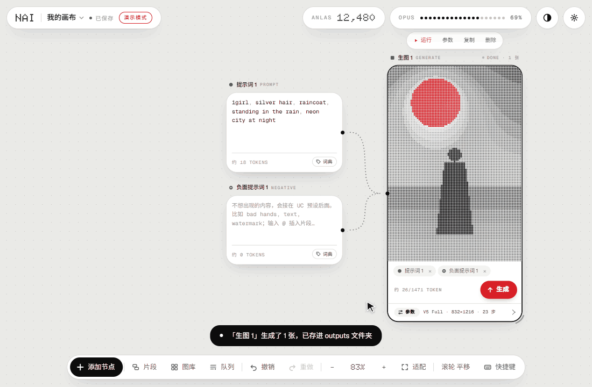
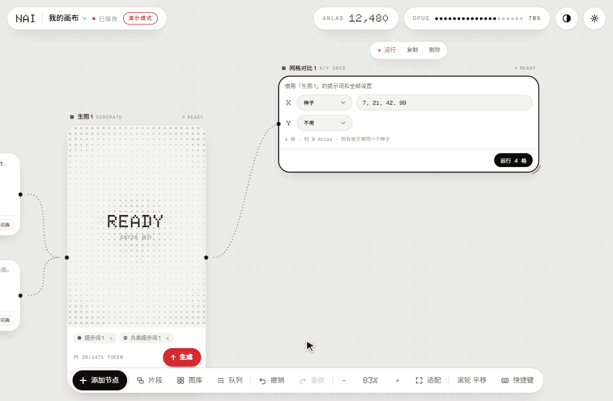
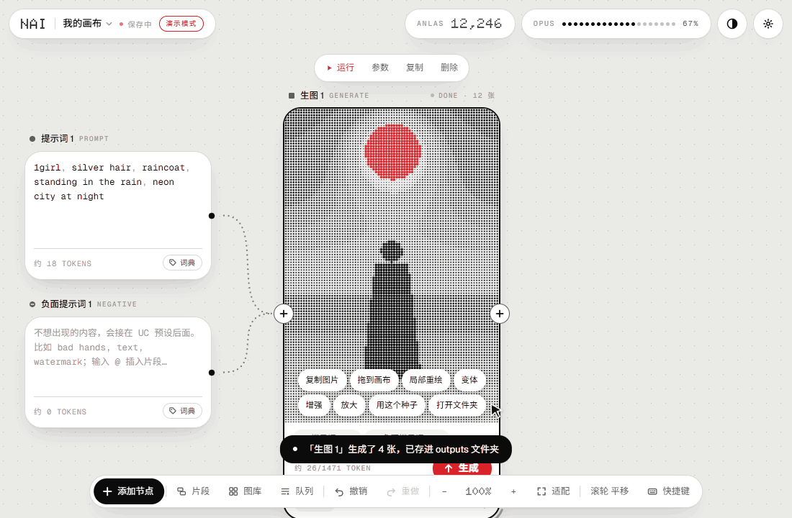

<div align="center">

# NAI Canvas

**把 NovelAI 生图搬到一张无限画布上：提示词、角色、画师串、参考图都是节点，连起来就能出图**

[](LICENSE)




</div>

> [!NOTE]
> 动图都是在「演示模式」下录的：不调用 NovelAI，画面里是本地生成的点阵占位图。

## 这是什么

NAI Canvas 是一个在自己电脑上运行的 NovelAI 生图客户端。界面是一张节点画布：提示词、负面提示词、角色、画师串、图片、风格参考都是节点，接到「生图」节点上就能出图，结果还可以继续接到图片工具、网格对比、局部重绘里。

- **在本机运行**：一个小的 Node 服务在本机转发 NovelAI 的接口，只监听 `127.0.0.1`
- **Token 留在本机**：保存在 `data/config.json`，只会发给 NovelAI
- **图片直接存到本地**：默认存进 `outputs` 文件夹，按日期分好
- **功能覆盖官网生图页**：模型、参数、多角色、图生图、局部重绘、风格参考、精确参考、Director Tools、放大，都能用

> [!IMPORTANT]
> 这是个人开发的非官方工具，和 NovelAI / Anlatan 没有关系。使用需要你自己的 NovelAI 订阅，并遵守 NovelAI 的服务条款。

## 功能

### 节点和连线



- 从节点两侧的 `+` 拉线；松在空白处会列出能接上的节点，选一个就自动接好
- 鼠标移到线上，中间出现 `×`，点一下就断开，提示里可以撤销
- 节点之间不会重叠，拖动时自动对齐；可以把一组节点框成分区，一键运行分区里的全部节点
- 撤销 / 重做、Alt + 拖动复制、多张画布、画布导出导入（连图片一起打包成 zip）

### 生图和参数



- 模型：V5 Full / Curated、V4.5 Full / Curated、V4 Full / Curated
- 点生图卡片最下面的「参数」（或按 `P`），参数卡片会贴在生图卡片旁边打开：尺寸预设和方向、步数、张数、种子锁定、负面提示词和 UC 预设、质量标签、Furry 模式、透明背景、提示词遵循度、采样器、噪声计划等
- 流式预览：生成时实时显示画面，卡片上方显示步数和预计剩余时间
- 悬停「生成」按钮能看到这次要花多少 Anlas；在 Opus 免费额度内会标出「免费」
- 多角色（V4 及以上）：每个角色一个节点，可以选在画面里的位置

### 提示词

- 编辑器会高亮 `{}`、`[]` 和 `1.5::tag::` 这类权重写法，写错的地方会标出来
- 输入时补全标签（用 NovelAI 的标签建议接口），按所选模型的分词器计算 token
- 片段库：把常用的一段存成片段，输入 `@` 插入，生成前自动展开；`||红发|蓝发||` 这样写每张图随机选一个
- 提示词词典：把常用的正面、负面提示词存起来，点一下就接在后面

### 画师串和角色字典



- 画师串节点：画师串存在全局的库里，所有画布共用；每个画师一条点状权重条，拖一下就改权重
- 接到生图节点后，画师串固定排在提示词最前面
- 可以用固定种子给画师串生成一张封面，也可以把满意的结果设为封面
- 角色字典节点：保存常用角色的提示词和多套服装，拖到画布上就是一个角色节点

### 图生图、局部重绘和编辑



- 图生图、局部重绘、扩图、变体、增强、2 倍放大
- 内置绘画编辑器：图层、画笔、选区和变换、填充、仿制图章、模糊、HSV 调整
- 风格参考（Vibe Transfer，支持导入导出 `.naiv4vibe`）和精确参考（V4.5）
- 图片工具（Director Tools）：去背景、去杂物、线稿、草图、上色、改表情、放大、像素整理

### 网格对比



- 从生图节点拉一个网格对比，选好 X / Y 轴（提示词替换、遵循度、步数、采样器、种子、模型等），一键跑完
- 喜欢哪一格，点「用这组参数」写回生图节点；整张网格可以连同行列标题导出成一张图

### 图库



- 全屏图库：按日期、模型、类型、收藏筛选，搜索提示词，看大图、翻页、放大
- 多选批量操作；删除的图进回收站，可以恢复；图可以钉到画布上
- 也可以在画布上放一个图库节点，它的输出口能直接当底图用
- 把带生成信息的 PNG 拖进来（包括 NovelAI 写在透明通道里的隐藏信息），可以还原成节点

### 其他

- 生成队列、文件名模板、按日期分文件夹、输出 PNG 或 WebP
- 浅色 / 深色主题、文字大小、新手引导、快捷键说明（按 `?`）

## 开始使用

### 需要准备

- Windows：启动脚本是 `启动.bat`。其他系统见[下面](#macos--linux)
- [Node.js](https://nodejs.org) 24（开发和测试用的版本）
- pnpm：`npm install -g pnpm`
- NovelAI 订阅，以及 Persistent API Token（以 `pst-` 开头，在 NovelAI 官网的账号设置里生成）

### 运行

1. 下载代码：`git clone`，或者在 GitHub 页面点 Code → Download ZIP 后解压
2. 双击 `启动.bat`。第一次会自动安装依赖、构建界面，然后在 <http://localhost:8787> 启动并打开浏览器
3. 点右上角的设置，填入 Token

关掉命令行窗口就退出了。更新代码后再双击一次 `启动.bat`，会重新构建界面。

### macOS / Linux

没有专门测试过，可以手动运行：

```bash
pnpm install
pnpm build
pnpm start
```

然后打开 <http://localhost:8787>。

### 演示模式

还没有 Token，或者不想消耗 Anlas，可以用演示模式试试：不调用 NovelAI，按真实流程生成点阵占位图。

```bash
pnpm install
pnpm dev:mock
```

然后打开 <http://localhost:5173>。

## 数据放在哪

| 位置 | 内容 |
|---|---|
| `data/config.json` | Token 和设置 |
| `data/projects/` | 画布 |
| `data/artists.json`、`data/characters.json`、`data/prompts.json`、`data/chunks.json` | 画师串库、角色字典、提示词词典、片段库 |
| `data/library.json`、`data/thumbs/` | 图库索引和缩略图 |
| `data/uploads/`、`data/vibes/` | 拖进来的图片、风格参考 |
| `outputs/` | 生成的图（默认按日期分文件夹，位置可以在设置里改）；删除的图在 `outputs/.trash` |

`data/` 和 `outputs/` 都在 `.gitignore` 里，不会被提交。备份时把这两个文件夹复制走就行。

可选的环境变量：

| 变量 | 作用 | 默认 |
|---|---|---|
| `PORT` | 本地服务端口 | `8787` |
| `NAI_DATA_DIR` | 数据目录 | `data` |
| `NAI_OUTPUT_DIR` | 图片输出目录 | `outputs` |
| `NAI_MOCK` | 设为 `1` 时使用演示模式 | 不开 |
| `OPEN_BROWSER` | 设为 `1` 时启动后自动打开浏览器（`启动.bat` 默认会设） | 不开 |
| `NAI_NO_BROWSER` | 设为 `1` 时 `启动.bat` 不自动打开浏览器 | 不开 |

## 常用操作

| 操作 | 方式 |
|---|---|
| 添加节点 | 双击空白处，或者从 `+` 拉线到空白处 |
| 菜单 | 右键 |
| 平移 / 缩放画布 | 滚轮 / Ctrl + 滚轮；也可以右键、中键或按住空格拖动 |
| 运行选中的节点 | `Enter` |
| 撤销 / 重做 | `Ctrl+Z` / `Ctrl+Shift+Z` |
| 原地复制一份 | `Ctrl+D`，或者 Alt + 拖动 |
| 框成分区 | `Ctrl+G` |
| 搜索节点 | `Ctrl+F` |
| 切换历史图 | `←` / `→` |
| 展开 / 收起参数 | `P` |
| 隐藏生图节点的底栏 | `H` |
| 适配全部节点 | `Shift+1` |
| 全部快捷键 | `?` |

## 开发

```bash
pnpm install
pnpm dev         # 本地服务 + 前端开发模式（http://localhost:5173）
pnpm dev:mock    # 同上，演示模式
pnpm test        # 单元测试（vitest）
pnpm typecheck   # 类型检查
pnpm build       # 构建前端到 web/dist
pnpm demos       # 重新录 README 里的动图
```

```text
shared/   前后端共用：模型和参数、提示词解析、计费、文件名模板等
server/   本地服务（Hono）：转发 NovelAI 接口，保存画布、图片和图库索引
web/      界面（React 19、React Flow、CodeMirror 6、zustand）
scripts/  启动、开发和录演示动图的脚本
docs/     功能调研（FEATURES.md）、开发计划和记录（PLAN.md）、演示动图
```

### 重新录演示动图

改了界面以后，可以用 `pnpm demos` 把 README 里的动图重新录一遍，也可以只录其中几个：`pnpm demos hero params`。场景有 `hero`、`wires`、`params`、`artist`、`inpaint`、`grid`、`gallery`，写在 `scripts/demos/scenes.mjs` 里。

- 需要本机装有 Chrome（或 Edge、Chromium）和 [ffmpeg](https://ffmpeg.org)；找不到时用 `CHROME_PATH`、`FFMPEG` 环境变量指定路径
- 每个场景都单独起一个演示模式的服务，数据放在系统临时目录，录完自动删掉，不会动 `data/` 和 `outputs/`
- 默认输出到 `docs/media/`；`--out <目录>` 换输出位置，`--keep` 保留临时目录。某个场景没录成时，会留下临时目录和现场截图

## 许可证

[GNU AGPL-3.0](LICENSE)。可以自由使用、修改和分发；分发修改后的版本，或者把修改后的版本作为网络服务给别人用时，需要按同样的协议公开对应的源代码。

NovelAI 是 Anlatan 的商标。本项目与 NovelAI / Anlatan 没有任何关联。
